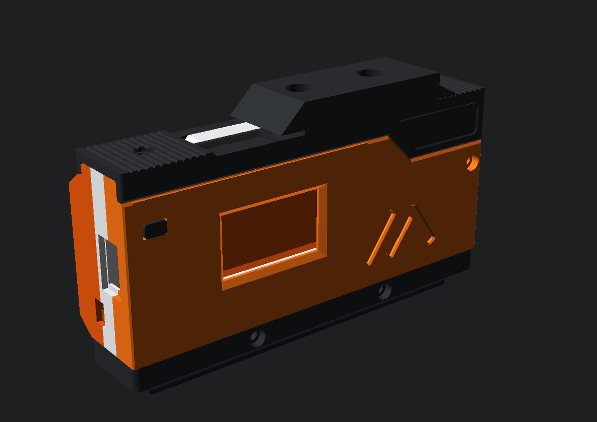
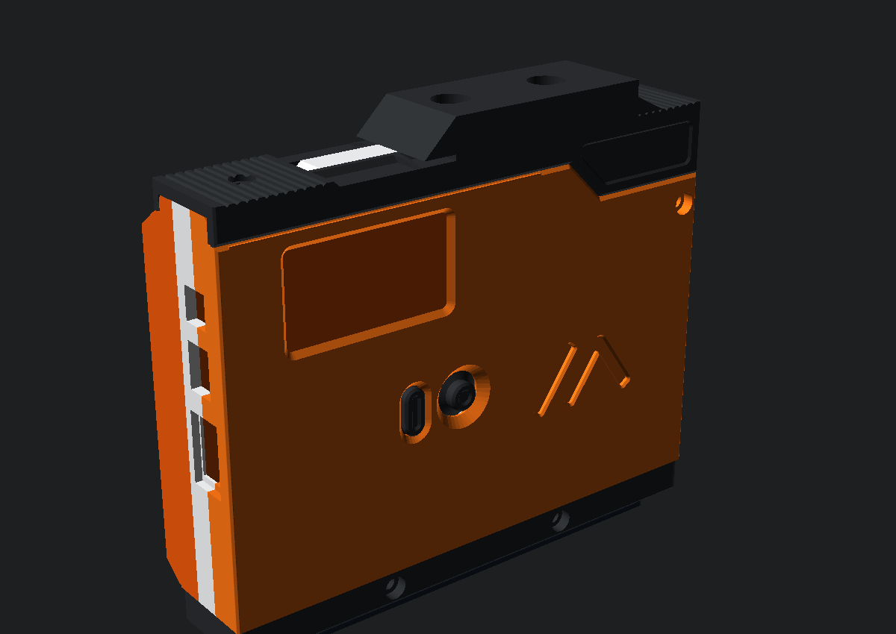
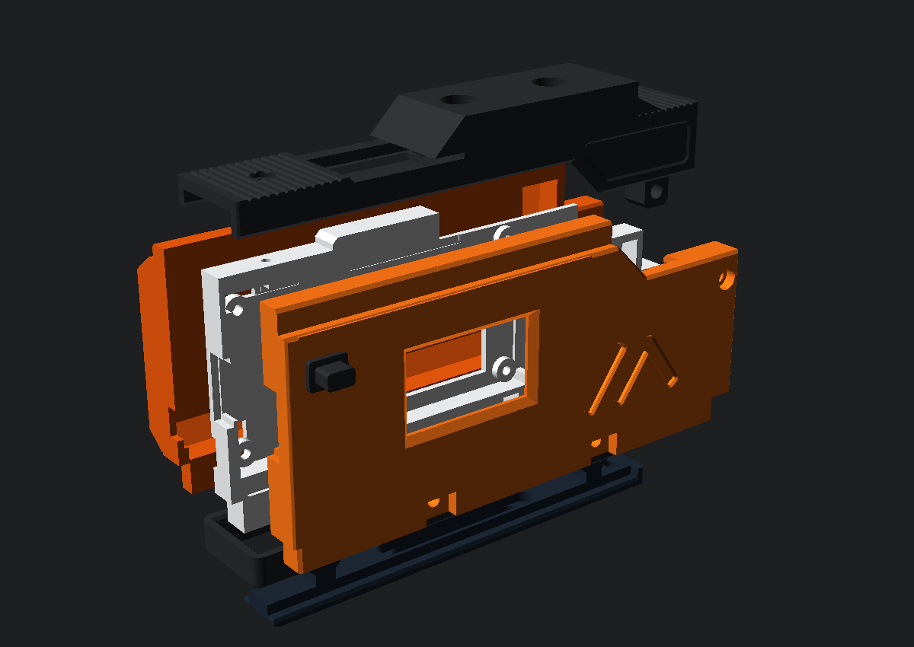
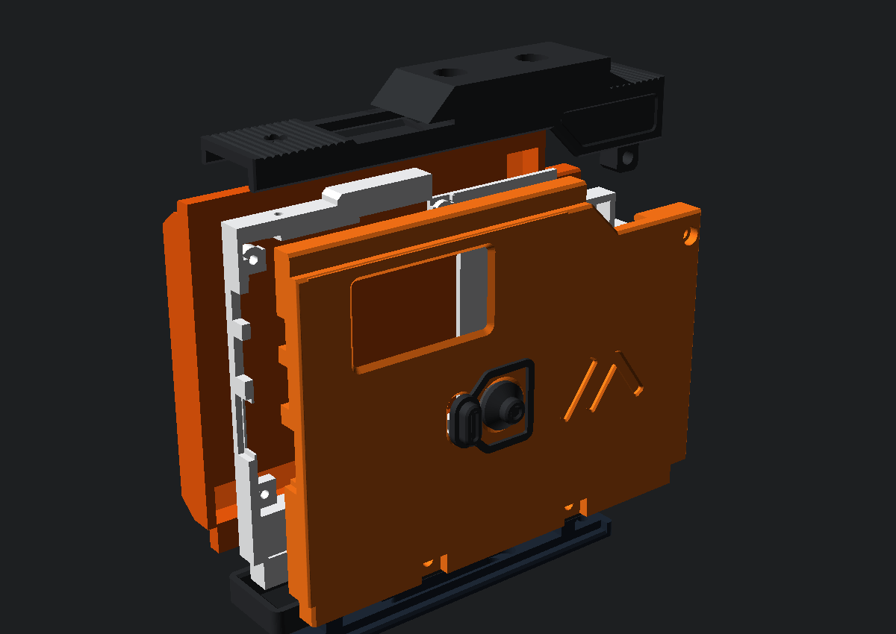
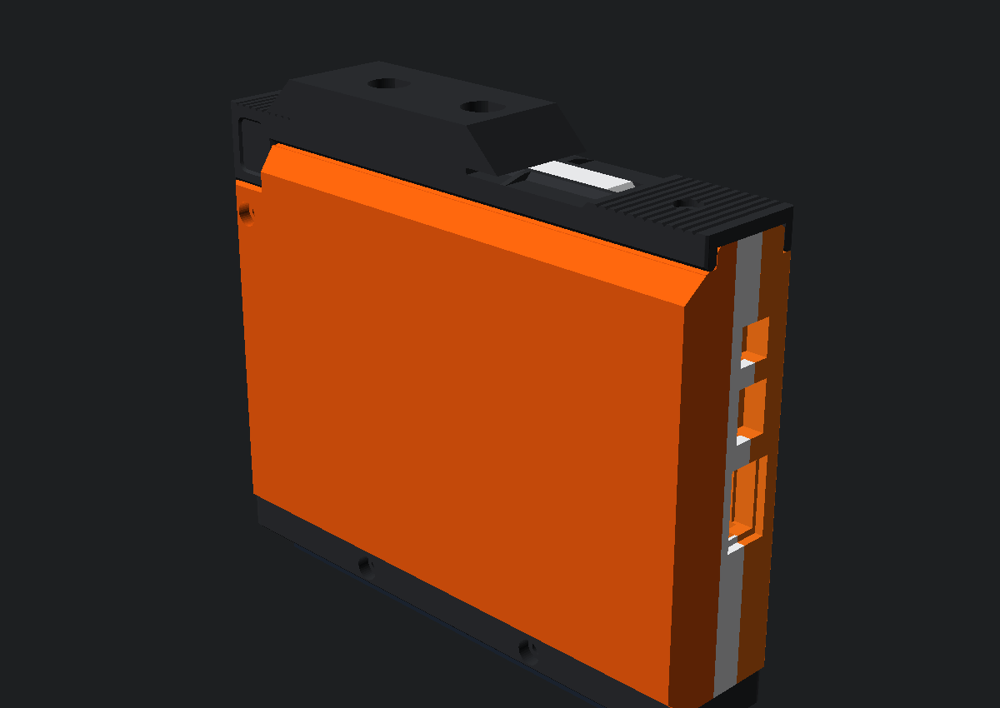
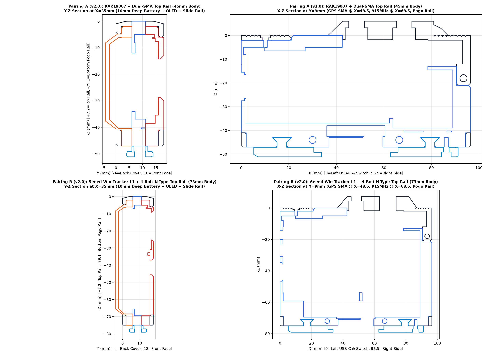
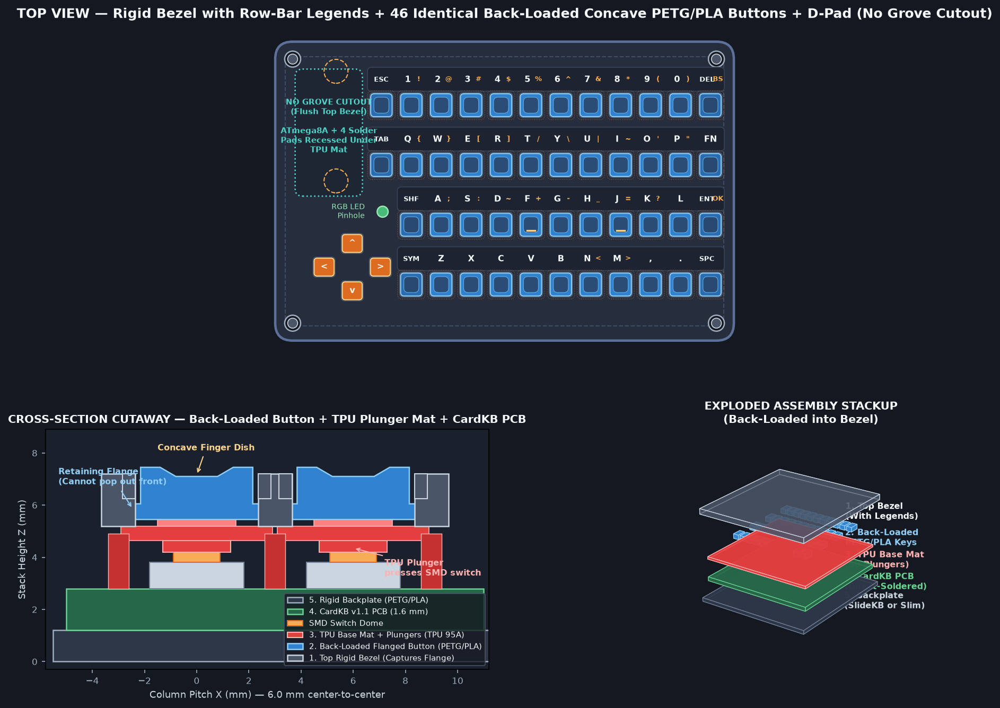
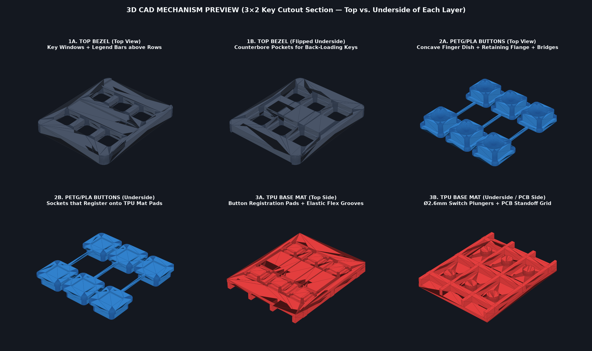
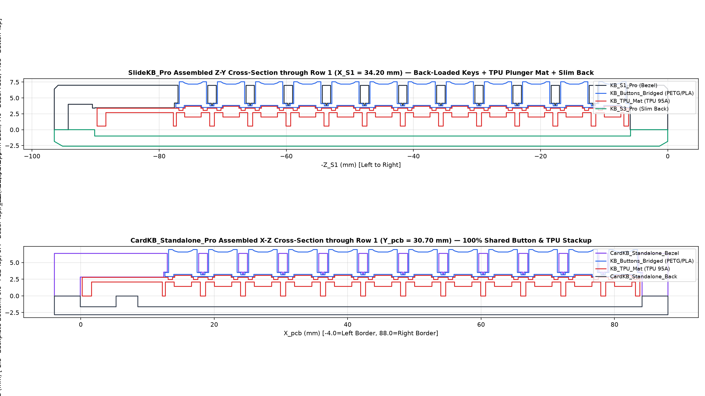
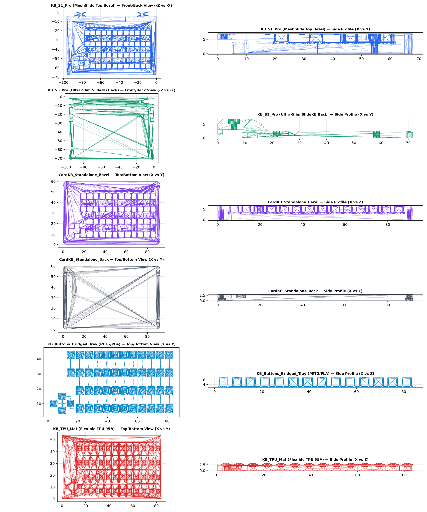

# MeshSlide-DualRF — Modular Meshtastic Enclosure for RAK WisBlock & Seeed Wio Tracker L1 (N-Type 915 MHz + SMA GPS)

A dual-platform, ruggedized remake of [Prokuon's MeshSlide](https://github.com/Prokuon/MeshSlide) engineered to house **both** the **RAK WisBlock (`RAK19007` + `RAK4631` + `RAK12500` + `0.96" OLED`)** and the **Seeed Studio Wio Tracker L1 (`1.3" OLED` + 4-Way Joystick)** via swappable internal carrier trays (`CaseM1_*` & `CaseU1_*`), upgraded with **top-mounted vertical N-Type (915 MHz) and SMA (GPS) bulkheads**, a **`+10 mm` expanded body height**, a **`+4 mm` deep LiPo battery cover (`CaseL1_Deep`)**, a captive pocket for the **Rokland 2-Pin JST-PH 2.0 Inline Power Switch (PID 920452)**, and **4-wire Grove I2C pogo rail wiring**—while maintaining **100% mechanical and electrical compatibility** with all original MeshSlide slide-on modules (`SlideKB`, `SlideZero`, `SlideRotary`, `SlideTriple`).

---

## Visual Previews

| RAK19007 + 0.96" OLED Assembly | Seeed Wio Tracker L1 (1.3" OLED + Joystick) Assembly |
| :---: | :---: |
|  |  |
|  |  |

| Rear Deep Battery Cover & Left-Side USB-C + Rokland Switch Slot | Assembled Cross-Sections |
| :---: | :---: |
|  |  |

---

## Key Upgrades Over Original MeshSlide

1. **Swappable Dual-Platform Trays (`CaseM1` + `CaseU1`)**:
   - **Option A — RAK WisBlock (`CaseM1_RAK` + `CaseU1_RAK`)**: Precision `60.4 × 30.4 mm` cradle with 4× M2 mounting standoffs (`55.2 × 25.2 mm` hole pattern) for `RAK19007` + `RAK4631` + `RAK12500`, paired with a front faceplate featuring a beveled `25.0 × 14.5 mm` viewing window and recessed mount for a `0.96" I2C OLED` (`RAK1921` / `SSD1306`) and a tactile Reset button actuator.
   - **Option B — Seeed Studio Wio Tracker L1 Out-of-the-Box (`CaseM1_WioL1_v2.0` + `CaseU1_WioL1_v2.0` + `CaseL1_Deep_WioL1_v2.0` + `CaseButton_WioL1_v2.0` + `CaseJoystick_v2.0`)**: Dimensioned directly from Seeed Studio's official `Wio_Tracker_L1_outline.dxf` and `L1pro_3D_Enclosure.stp` (`48.06 × 52.00 mm` bare PCB inside a stepped cradle with 4× corner M2 mounting standoffs at `43.06 × 47.00 mm` spacing, housed in a `+38.0 mm` expanded `73.0 mm` / `75.0 mm` tall body with a `19.0 mm` tall lower Grove cable plug bay) **without removing or modifying the OLED ribbon cable**. Includes full-depth switch-side solder-pin clearance (`X = 1.50..7.50 mm`), a rear SMD magnetic buzzer clearance window (`X = 39.0..51.5 mm, Z = 33.5..50.5 mm`), and the proven MakerWorld `1.3" OLED` front bezel, captive flex-frame Menu pill button (`CaseButton_WioL1_v2.0`), and conical-skirt 5-way Joystick cap (`CaseJoystick_v2.0`).
2. **Dual Vertical Top-Mounted RF Bulkhead Rails (`CaseS1_DualRF_v2.0` & `CaseS1_DualRF_BoltOn_v2.0`)**:
   - **Option 1 — Dual-SMA (`CaseS1_DualRF_v2.0`)**: Flush `18.0 mm` wide top rail with **915 MHz LoRa SMA** at `X = 68.50 mm, Y = 9.00 mm` and **GPS SMA** at `X = 48.50 mm, Y = 9.00 mm` (`Ø6.60 mm` 1/4"-36 UNS D-holes with `6.15 mm` anti-rotation flats and unbroken `6.20 mm` deep `8.25 mm` 6-sided internal hex nut sockets).
   - **Option 2 — Outside-Mount 4-Bolt Square-Flange N-Type + GPS SMA (`CaseS1_DualRF_BoltOn_v2.0`)**: Features a `27.4 × 26.8 mm` (`6.0 mm` thick) top flange pad at `X = 68.50 mm, Y = 9.00 mm` (`Z = -7.20..-1.20 mm`, completely above the `Z = +1.80 mm` slide rails) for a standard `25 × 25 mm` 4-hole Square-Flange N-Type connector (`Ø10.60 mm` center bore, `4× Ø3.40 mm` M3 holes on an `18.30 × 18.30 mm` grid, and `4×` captive `5.75 mm` AF M3 hex nut sockets underneath), plus the **GPS SMA** port at `X = 48.50 mm, Y = 9.00 mm`.
3. **Expanded Battery Bay (`CaseL1_Deep`) & Captive Rokland Switch Mount**:
   - Main body height is expanded by **`+10.0 mm`** (`35 mm` → `45 mm` outer covers; `37 mm` → `47 mm` internal `CaseM1` frame) and rear cover depth by **`+4.0 mm`** (`6 mm` → `10 mm`), fitting standard `2000–3000 mAh` LiPo pouch cells up to **`10 × 34 × 82 mm`** (such as `103450` or the Wio L1 Pro 2000 mAh cell).
   - Left perimeter wall of the **RAK WisBlock** build (`CaseL1_Deep` + `CaseM1_RAK`) includes a captive internal pocket (`9.0 × 4.3 × 4.6 mm`) and external slider window (`5.6 × 2.8 mm`) sized for the **[Rokland RAK Wireless 2-Pin JST-PH 2.0 Battery Cable with Power Switch (PID 920452)](https://store.rokland.com/products/rak-wireless-2-pin-jst-ph-2-0-battery-cable-with-power-switch-pid-920452)**. The **Wio Tracker L1** build (`CaseL1_Deep_WioL1` + `CaseM1_WioL1`) omits that extra rear slot so the rear-left wall behind the USB-C port is completely solid, using the Wio's own onboard ON/OFF switch right above the USB-C port.
4. **4-Wire Grove I2C Pogo Harness & 100% Slide-Module Compatibility**:
   - Bottom collar (`CaseR1`) and pogo slide rail (`CaseSlide` / `S2`) retain the **exact original geometry**, so `SlideKB` (CardKB), `SlideZero` (lanyard cover), `SlideRotary`, and `SlideTriple` slide on without any changes.
   - Wiring just 4 pins (`GND, SCL, SDA, 3V3`) to a standard 4-pin Grove cable (`HY2.0-4P`) lets you swap between the Wio Tracker L1 (native onboard Grove port) and RAK19007 (4-pin I2C header) without desoldering.

---

## Repository File Map & Versioned Structure (`v2.0`)

All active models carry the explicit **`_v2.0`** version tag (configured via `MODEL_VERSION = "v2.0"` in [`cad/config.py`](file:///c:/Users/hanse/Documents/antigravity/splendid-bohr/cad/config.py) and documented in [`VERSION.md`](file:///c:/Users/hanse/Documents/antigravity/splendid-bohr/VERSION.md)). All legacy/unversioned `v1.0` files are stored in [`archive/`](file:///c:/Users/hanse/Documents/antigravity/splendid-bohr/archive):

| Directory | Contents & Purpose |
| :--- | :--- |
| [`STL/Wio_Tracker_L1_v2.0/`](file:///c:/Users/hanse/Documents/antigravity/splendid-bohr/STL/Wio_Tracker_L1_v2.0) | **Complete 9-part Seeed Wio Tracker L1 set (`v2.0`)**: `CaseS1_DualRF_v2.0` (Dual-SMA), `CaseS1_DualRF_BoltOn_v2.0` (Outside-Mount 4-Bolt N-Type + GPS SMA), `CaseL1_Deep_WioL1_v2.0`, `CaseM1_WioL1_v2.0`, `CaseU1_WioL1_v2.0`, `CaseButton_WioL1_v2.0`, `CaseJoystick_v2.0`, `CaseR1_v2.0`, and `CaseSlide_v2.0`. |
| [`STL/RAK_WisBlock_v2.0/`](file:///c:/Users/hanse/Documents/antigravity/splendid-bohr/STL/RAK_WisBlock_v2.0) | **Complete 8-part RAK WisBlock set (`v2.0`)**: `CaseS1_DualRF_v2.0`, `CaseS1_DualRF_BoltOn_v2.0`, `CaseL1_Deep_v2.0`, `CaseM1_RAK_v2.0`, `CaseU1_RAK_v2.0`, `CaseButton_v2.0`, `CaseR1_v2.0`, and `CaseSlide_v2.0`. |
| [`STL/CardKB_Pro_v2.0/`](file:///c:/Users/hanse/Documents/antigravity/splendid-bohr/STL/CardKB_Pro_v2.0) | **CardKB Pro Hybrid Enclosure (`v2.0`)**: `KB_TPU_Mat_v2.0`, `KB_Buttons_Bridged_Tray_v2.0`, `KB_Buttons_Loose_Set_v2.0`, `KB_Button_Single_Main_v2.0`, `KB_S1_Pro_v2.0`, `KB_S3_Pro_v2.0`, `KB_Bezel_Legends_AMS_v2.0`, `CardKB_Standalone_Bezel_v2.0`, and `CardKB_Standalone_Back_v2.0`. |
| [`STEP/`](file:///c:/Users/hanse/Documents/antigravity/splendid-bohr/STEP) | Parallel versioned folders (`Wio_Tracker_L1_v2.0/`, `RAK_WisBlock_v2.0/`, `CardKB_Pro_v2.0/`) with ISO AP214 STEP CAD files (`*_v2.0.step`). |
| [`3MF/`](file:///c:/Users/hanse/Documents/antigravity/splendid-bohr/3MF) | Versioned single-plate 3MF bundles: [`Top_Antenna_Rail_BoltOn_N_Only_v2.0.3mf`](file:///c:/Users/hanse/Documents/antigravity/splendid-bohr/3MF/Top_Antenna_Rail_BoltOn_N_Only_v2.0.3mf), [`Top_Antenna_Rail_Dual_SMA_Only_v2.0.3mf`](file:///c:/Users/hanse/Documents/antigravity/splendid-bohr/3MF/Top_Antenna_Rail_Dual_SMA_Only_v2.0.3mf), [`Wio_Tracker_L1_Updated_Parts_v2.0.3mf`](file:///c:/Users/hanse/Documents/antigravity/splendid-bohr/3MF/Wio_Tracker_L1_Updated_Parts_v2.0.3mf), [`MeshSlide_WioTrackerL1_Kit_v2.0.3mf`](file:///c:/Users/hanse/Documents/antigravity/splendid-bohr/3MF/MeshSlide_WioTrackerL1_Kit_v2.0.3mf), [`MeshSlide_RAK19007_Kit_v2.0.3mf`](file:///c:/Users/hanse/Documents/antigravity/splendid-bohr/3MF/MeshSlide_RAK19007_Kit_v2.0.3mf), and [`CardKB_Pro_Hybrid_Kit_v2.0.3mf`](file:///c:/Users/hanse/Documents/antigravity/splendid-bohr/3MF/CardKB_Pro_Hybrid_Kit_v2.0.3mf). |
| [`archive/`](file:///c:/Users/hanse/Documents/antigravity/splendid-bohr/archive) | Archived `v1.0` files and legacy folder layouts. |
| [`VERSION.md`](file:///c:/Users/hanse/Documents/antigravity/splendid-bohr/VERSION.md) | Release version notes (`v2.0` vs archived `v1.0`). |
| [`OpenSCAD/MeshSlide_DualRF.scad`](file:///c:/Users/hanse/Documents/antigravity/splendid-bohr/OpenSCAD/MeshSlide_DualRF.scad) | Interactive OpenSCAD Customizer & exploded assembly viewer. |
| [`cad/config.py`](file:///c:/Users/hanse/Documents/antigravity/splendid-bohr/cad/config.py) & [`cad/build_all.py`](file:///c:/Users/hanse/Documents/antigravity/splendid-bohr/cad/build_all.py) | Parametric Python CAD generator scripts (`MODEL_VERSION = "v2.0"`). |
| [`tests/verify_models.py`](file:///c:/Users/hanse/Documents/antigravity/splendid-bohr/tests/verify_models.py) | Automated manifold, dimensional, and 0.00 mm³ collision verification suite. |

---

## CardKB Pro Hybrid Enclosure (`SlideKB_Pro` & `CardKB_Standalone_Pro`)

A custom low-profile hybrid keyboard enclosure for the **M5Stack CardKB v1.1 (`ATmega8A`, `84.0 × 54.0 × 1.6 mm` bare PCB)** that combines the dust-sealing elastomer membrane of **HarukiToreda's Silicone Cover for CardKB** with the crisp rigid keycaps of **Printables #1512657 Modular CardKB Case**—engineered specifically for **direct-soldered 4-wire I2C harnesses** (no bulky Grove connector bulge):

| CardKB Pro Layout, Stackup & Form Factors | 3D Component & Mechanism Close-Up |
| :---: | :---: |
|  |  |
|  |  |

### Key Design Features
1. **Continuous TPU 95A/85A Base Mat ([`KB_TPU_Mat_v2.0.stl`](file:///c:/Users/hanse/Documents/antigravity/splendid-bohr/STL/CardKB_Pro_v2.0/KB_TPU_Mat_v2.0.stl))**:
   - Single-piece `84.0 × 54.0 mm` flexible membrane (`0.60 mm` base web with `0.35 mm` elastic flex groove rings around all 50 keys) that seals the PCB against dust/debris.
   - Features `50× Ø2.60 mm` underside cylindrical plungers that press the SMD tactile switches (`0.10 mm` zero-rattle pre-tension), `2.5 × 2.5 × 0.30 mm` top registration bosses that lock into the underside of each rigid button, perimeter + horizontal support ribs (`2.10 mm` standoff height), `2× Ø4.50 mm` alignment pins for the CardKB's `Ø4.80 mm` Lego registration holes, and a top-left clearance pocket (`21.5 × 24.5 mm`) over the `ATmega8A` MCU and 4 direct-soldered wire pads.
2. **Back-Loaded Rigid PETG/PLA Buttons + Bezel-Bar Legends**:
   - Exploits the CardKB's generous `12.0 mm` vertical row pitch (`6.30 mm` solid bezel bars between switch rows) by placing crisp `0.45 mm` debossed character legends on the **bezel bars directly above each button** (plus [`KB_Bezel_Legends_AMS_v2.0.stl`](file:///c:/Users/hanse/Documents/antigravity/splendid-bohr/STL/CardKB_Pro_v2.0/KB_Bezel_Legends_AMS_v2.0.stl) for flush multi-color AMS/MMU printing).
   - Because legends are on the bezel, all 46 main keys share **one identical concave sculpt** (`4.60 × 4.60 mm` top dish with a `5.70 × 5.70 × 0.60 mm` bottom retention flange)—no sorting tiny keys during assembly.
   - Includes **both** a 1-piece drop-in connected button array ([`KB_Buttons_Bridged_Tray_v2.0.stl`](file:///c:/Users/hanse/Documents/antigravity/splendid-bohr/STL/CardKB_Pro_v2.0/KB_Buttons_Bridged_Tray_v2.0.stl) with `0.44 × 0.26 mm` compliant flange bridges) **and** discrete loose buttons ([`KB_Buttons_Loose_Set_v2.0.stl`](file:///c:/Users/hanse/Documents/antigravity/splendid-bohr/STL/CardKB_Pro_v2.0/KB_Buttons_Loose_Set_v2.0.stl) / [`KB_Button_Single_Main_v2.0.stl`](file:///c:/Users/hanse/Documents/antigravity/splendid-bohr/STL/CardKB_Pro_v2.0/KB_Button_Single_Main_v2.0.stl)).
3. **Dual Form Factors (No Grove Cutout — Direct Solder)**:
   - **Option 1 — MeshSlide `SlideKB_Pro` ([`KB_S1_Pro_v2.0.stl`](file:///c:/Users/hanse/Documents/antigravity/splendid-bohr/STL/CardKB_Pro_v2.0/KB_S1_Pro_v2.0.stl) + [`KB_S3_Pro_v2.0.stl`](file:///c:/Users/hanse/Documents/antigravity/splendid-bohr/STL/CardKB_Pro_v2.0/KB_S3_Pro_v2.0.stl))**: Mates with the existing MeshSlide `KB_S2.STL` slide rail and `KB_M1.STL` 8-pin magnetic pogo mount (`96.5 × 64.9 × 11.4 mm` total thickness, saving `3.2 mm` over the stock `KB_S3.STL` by eliminating the Grove bulge and routing the 4 soldered wires through a concealed internal raceway).
   - **Option 2 — Standalone Ultra-Slim Pocket Enclosure ([`CardKB_Standalone_Bezel_v2.0.stl`](file:///c:/Users/hanse/Documents/antigravity/splendid-bohr/STL/CardKB_Pro_v2.0/CardKB_Standalone_Bezel_v2.0.stl) + [`CardKB_Standalone_Back_v2.0.stl`](file:///c:/Users/hanse/Documents/antigravity/splendid-bohr/STL/CardKB_Pro_v2.0/CardKB_Standalone_Back_v2.0.stl))**: `92.0 × 60.0 × 7.60 mm` total thickness (`4× M2 × 6 mm` corner screws) with a recessed top-edge wire strain-relief channel (`3.6 × 1.8 mm` with S-bend anchor ribs) for direct 4-wire tethered use.

---

## Bill of Materials (BOM)

### Shared Hardware (Used by Both Platforms)
1. **915 MHz LoRa Pigtail**: `1×` IPEX (U.FL / MHF1) to **N-Type Female Bulkhead** cable (`10 cm` RG178 or 1.13 mm coax, 16 mm / 5/8"-24 thread with hex nut & lock washer).
2. **GPS Antenna Pigtail**: `1×` IPEX (U.FL / MHF1) to **SMA Female Bulkhead** cable (`8–10 cm` RG178 / 1.13 mm coax).
3. **Antennas**: `1×` N-Type Male 915 MHz antenna + `1×` SMA Male active/passive GPS antenna.
4. **Power Switch Harness**: `1×` [Rokland RAK Wireless 2-Pin JST-PH 2.0 Battery Cable with Power Switch (PID 920452)](https://store.rokland.com/products/rak-wireless-2-pin-jst-ph-2-0-battery-cable-with-power-switch-pid-920452).
5. **Battery**: `1×` 3.7V LiPo pouch cell up to `10 × 34 × 82 mm` (e.g., `103450` 2000 mAh or `103665` 2500–3000 mAh).
6. **Magnetic Pogo Connector**: `1×` 8-Pin Magnetic Pogo Female Socket (`CaseSlide` / `S2` mount, 2.54 mm pitch, 30 mm flange spacing).
7. **Grove I2C Cable**: `1×` 4-Pin Grove (`HY2.0-4P`) pigtail (`~8 cm`).
8. **Fasteners** (identical to original MeshSlide):
   - `3×` **M2 × 5 mm** double-pass knurled brass heat-set nuts (`OD 3.0 mm`) — `2×` pressed into bottom of `CaseM1_*`, `1×` pressed into right leg of `CaseS1_DualRF`.
   - `6×` **M2 × 7 mm** hex socket head cap screws (`4×` through `CaseR1` at bottom front/back, `2×` through right side of `CaseU1`/`CaseL1` into `CaseS1_DualRF`).
   - `1×` **M2 × 5 mm** hex socket head cap screw (locks `CaseSlide` into bottom of `CaseM1_*`).
   - `1×` **M2 × 4 mm** flat-head countersunk screw (secures left top of `CaseS1_DualRF` into `CaseM1_*`).

### Platform A: RAK WisBlock Kit
- `RAK19007` WisBlock Base Board (60 × 30 mm) + `RAK4631` Core (nRF52840 + SX1262) + `RAK12500` GNSS module (Slot A or C).
- `0.96" I2C OLED Display` (`RAK1921` / `SSD1306`, 4-pin `VCC, GND, SCL, SDA`).
- `4×` **M2 × 4 mm** screws (mount `RAK19007` onto `CaseM1_RAK`'s 4 standoffs).

### Platform B: Seeed Studio Wio Tracker L1 Kit
- `Seeed Studio Wio Tracker L1` (Standard version with onboard `1.3" OLED`, 4-way joystick, L76K GPS, and SX1262 LoRa).

---

## 4-Wire Grove I2C Pogo Pinout (`SlideKB` Compatible)

Looking at the back solder cups of the 8-pin female magnetic pogo socket (embedded in `CaseSlide`), solder the 4 wires of the Grove (`HY2.0-4P`) cable to **Pins 1, 2, 3, and 8** (matches the original MeshSlide `SlideKB` pinout):

| Pogo Pin (Left → Right) | Signal | Grove Wire Color (Standard) | Wio Tracker L1 Connection | RAK19007 Connection |
| :---: | :---: | :---: | :--- | :--- |
| **Pin 1** | `GND` | Black (Grove Pin 4) | Plug into onboard Grove I2C port | Solder/plug to `GND` header |
| **Pin 2** | `SCL` | Yellow (Grove Pin 1) | Plug into onboard Grove I2C port | Solder/plug to `I2C1_SCL` header |
| **Pin 3** | `SDA` | White (Grove Pin 2) | Plug into onboard Grove I2C port | Solder/plug to `I2C1_SDA` header |
| **Pins 4–7** | *Unused* | — | Leave unconnected | Leave unconnected |
| **Pin 8** | `3V3` | Red (Grove Pin 3) | Plug into onboard Grove I2C port | Solder/plug to `3V3` / `3V3_S` header |

---

## Regenerating CAD Models & Running Verification

To customize any dimension or tolerance, edit [`cad/config.py`](file:///c:/Users/hanse/Documents/antigravity/splendid-bohr/cad/config.py) and run:

```powershell
python cad/build_all.py
python tests/verify_models.py
```
